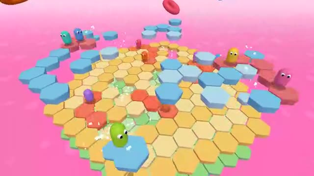

# Knockout Show

Survive each round. Last one standing wins. A multiplayer starter game from [Multiplayer Agent](https://multiplayeragent.com): 3D, party, 4–16 players, with bots that fill empty seats.

## How it plays

Three rounds: jump the spinning bar, dodge cannonballs while the floor drops away ring by ring, then a final on tiles that fall a moment after you step on them. Fall off and you're out. The last bean standing wins the crown.

**Controls:** WASD or arrow keys and Space, or the touch stick and Jump button.

## Make it yours in the Game Builder

Open the [Game Builder](https://multiplayeragent.com), choose **Start from a starter game** and pick Knockout Show. It opens as version 1 in your studio, ready to play and publish. Then ask for changes, for example:

- Add a race round to a finish line
- Add team rounds
- Add costumes you unlock by winning

## Run it yourself

1. Get a free publishable key (`pk_…`) at [multiplayeragent.com](https://multiplayeragent.com).
2. In `index.html`, put it in place of `pk_REPLACE_ME` in the `MP_CONNECT` block.
3. Serve the folder (for example `npx serve`) and open it. The 3D engine loads as a module, which browsers block from a file on disk.

Without a key it still runs, offline against bots.

## How it is built

- One `index.html` plus three.js in `libs/`. The comment at the top of the script maps the code and explains the multiplayer.
- **Host-run rounds:** The host's browser runs the show and counts who is out; if it leaves, the next player takes over.
- **Live sync:** Every bean, spinning bar and falling tile is the same for everyone.
- **Bots:** Bots fill the show until enough people join.
- **Leaderboard:** Crowns: the players who won the most shows.
- Each round type is one object in the `ARENAS` section. Add a round by copying one and putting its name in `CONFIG.show`.
- `?attract` runs it offline with bots only. The preview video is recorded from it.

## License

MIT. three.js in `libs/` is MIT too (Copyright 2010-2024 three.js authors).
